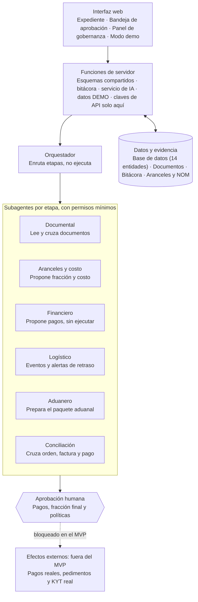

# SDD: Kiilonova Trade MVP — Expediente inteligente de importación

23 de noviembre de 2026 · Luis Armando Aguilar Pereyra

## Visión y alcance

El MVP demuestra una operación completa de importación desde China, de la orden de compra a la conciliación, con agentes que proponen y humanos que autorizan.

- **Qué es.** Una aplicación web, el "Expediente inteligente", donde una pyme mexicana abre una importación y el sistema organiza documentos, costo puesto en bodega, propuesta de pago, seguimiento y conciliación.
- **Para quién.** El dueño de la pyme importadora, que es el usuario, y quien debe decidir si la idea vale la pena (el jefe, distribuidores y fondos), que tiene que ver el valor en 8 minutos.
- **Qué prueba.** Que Kiilonova resuelve un dolor concreto, coordinar documentos, pagos y entregas, y que alguien pagaría por ello. No pretende probar que la arquitectura sea inteligente.
- **Punto de partida.** El Command Center de Lovable ya simula pagos y FX. Este MVP añade el expediente, los documentos, el costo puesto y la conciliación, que hoy no existen.
- **Dentro del alcance.** Un corredor (China → México), una categoría de producto con arancel claro, OCR y cruce de documentos, costo puesto en bodega, propuesta de pago en modo "solo proponer", seguimiento logístico simulado, conciliación, bitácora de auditoría y modo demo.
- **Fuera del alcance.** Mover dinero real, custodiar llaves, presentar pedimentos, KYT real, exportación México → China, BTC y Lightning, facturación multicliente y el autodespliegue de políticas evolucionadas.

## Principios del proyecto

Estos ocho artículos son la constitución del proyecto: el agente de código los lee antes de cada tarea y ninguna tarea puede violarlos. El flujo sigue el esquema de [Spec Kit](https://github.github.com/spec-kit/index.html): constitución, especificación, plan, tareas e implementación. La constitución es un archivo que acompaña [cada fase posterior](https://devblogs.microsoft.com/blog/spec-driven-development-spec-kit).

1. **Solo proponer, nunca ejecutar.** Ninguna función mueve dinero, firma o presenta algo ante una autoridad. Los pagos terminan en estado "propuesta" y el campo `execute` vale siempre `false`.
2. **Una persona autoriza.** Todo cambio con efecto externo exige una aprobación humana registrada: quién, cuándo y sobre qué versión.
3. **Nada sin evidencia.** Cada cifra y cada respuesta del asistente cita el documento o la tabla de origen. Si no hay evidencia, la respuesta es "sin dato".
4. **Lo simulado se ve simulado.** Todo dato de demo (tipo de cambio, cotización, ruta, evento de embarque) lleva la etiqueta DEMO. Ninguna cifra ilustrativa se presenta como medida.
5. **Sin secretos en el cliente.** Las claves de API viven solo en funciones de servidor. La app no almacena llaves privadas de wallets.
6. **Aranceles y normas versionados.** Cada tasa y cada NOM tiene fuente, fecha y vigencia. El agente nunca inventa una fracción o una tasa; si no la encuentra, escala a una persona.
7. **Bitácora solo de agregar.** Cada acción de un agente o de una persona se registra y no se edita.
8. **Terminado significa verificado.** Ninguna tarea se marca hecha sin que su prueba pase. Los cálculos de costo, FX y conciliación tienen pruebas con casos del spec.

## Historias de usuario y criterios de aceptación

Doce historias cubren la operación completa y las ocho de prioridad P1 bastan para la demo. Cada criterio es verificable con una prueba automática o con un paso del guion de demo.

| ID | Historia | Criterio de aceptación | Prio |
| --- | --- | --- | --- |
| US-01 | Como importador, abro un expediente desde una orden de compra para tener la operación en un solo lugar. | Al subir la orden de compra o llenar el formulario se crea el expediente con proveedor, mercancía, cantidad, importe y moneda. Los campos con confianza menor a 0.80 (umbral configurable) quedan marcados para revisión. | P1 |
| US-02 | Como importador, subo factura, lista de empaque, comprobante de pago y documento de transporte para que el sistema extraiga los datos. | Para los cuatro tipos extrae los campos del contrato y muestra su origen (página y recuadro). Un documento ilegible no bloquea el expediente y pasa a revisión manual. | P1 |
| US-03 | Como importador, quiero que el sistema detecte inconsistencias entre documentos. | En el set semilla hay 3 discrepancias plantadas (importe, cantidad y nombre del proveedor). Se detectan las 3, cada una con tipo, severidad y tarea de corrección, y los documentos limpios no generan alertas. | P1 |
| US-04 | Como importador, veo el costo puesto en bodega antes de pagar. | Dado producto, valor en USD y flete, calcula valor + arancel + DTA + IVA + flete + honorarios (editable). Muestra fracción propuesta, tasa con fuente y vigencia, y NOM aplicables. Si la fracción no está en la tabla, responde "sin dato" y pide revisión. | P1 |
| US-05 | Como importador, comparo rutas de pago para elegir una. | Con 100,000 MXN a 18.25 el bruto es 5,479.45 USD. Muestra al menos 2 rutas (banco y riel con stablecoin intermedio) con costo desglosado, tiempo y etiqueta DEMO. El botón dice "Enviar a aprobación", nunca "Pagar". | P1 |
| US-06 | Como persona autorizada, apruebo o rechazo propuestas desde una bandeja. | Cada propuesta muestra su evidencia y registra aprobador, fecha y versión. Un rechazo exige motivo. Al aprobar, el estado es "autorizada (simulada)" y no se mueve dinero. | P1 |
| US-07 | Como importador, sigo el estado logístico. | Línea de tiempo con orden confirmada, embarque, tránsito, arribo, liberación aduanal y entrega, cargada del escenario demo o a mano. Si la fecha estimada se vence, el expediente pasa a "retraso". | P2 |
| US-08 | Como importador, preparo el paquete para mi agente aduanal. | Genera la lista de documentos pendientes según el tipo de mercancía y exporta el expediente en un archivo. La app declara que el pedimento lo presenta el agente aduanal y pide confirmar la inscripción en el Padrón de Importadores. | P2 |
| US-09 | Como importador, concilio orden, factura, pago y recepción. | Cruza los cuatro registros y muestra saldo por pagar y estado (conciliado, con diferencia o pendiente). En el caso semilla el saldo coincide con el calculado a mano. | P1 |
| US-10 | Como importador, le pregunto al expediente en lenguaje natural. | Responde "¿Ya pagué?", "¿Cuánto falta?", "¿Qué documento falta?" y "¿Cuándo llega?" citando el registro de origen. Fuera del expediente responde "sin dato". | P2 |
| US-11 | Como responsable de gobernanza, reviso agentes, permisos y bitácora. | Panel de lectura con agentes, permisos y bitácora. Una propuesta de política evolucionada aparece como "sandbox, sin despliegue" y no existe ningún camino de despliegue automático. | P2 |
| US-12 | Como presentador, controlo la demo. | Selector de 3 escenarios (limpio, con discrepancia y con retraso), reinicio en un clic y etiqueta DEMO global visible en todas las pantallas. | P1 |

## Requisitos no funcionales y métricas de éxito

Los requisitos funcionales son los criterios de aceptación de la sección anterior (FR-01 a FR-12, uno por historia). Aquí van los no funcionales, cada uno con su objetivo y la prueba que lo verifica. Los objetivos son valores iniciales del spec, no mediciones.

| ID | Requisito | Objetivo | Cómo se verifica |
| --- | --- | --- | --- |
| NFR-01 | Velocidad de extracción | Un documento de una página en 20 s o menos (p95) | Prueba automatizada con el set semilla |
| NFR-02 | Precisión de extracción | 95% o más de los campos del set semilla correctos | Eval con respuestas conocidas |
| NFR-03 | Exactitud financiera | Error de redondeo de 0.01 USD o menos; decimales exactos, no flotantes | Pruebas unitarias con los casos del spec |
| NFR-04 | Carga de la demo | Pantalla inicial en menos de 3 s y plan B funcional sin red | Prueba de navegador y ensayo sin conexión |
| NFR-05 | Seguridad | Sin llaves en el cliente, acceso por organización y archivos en almacenamiento privado | Escaneo de secretos y prueba de acceso cruzado |
| NFR-06 | Trazabilidad | 100% de las acciones en una bitácora que no se puede editar ni borrar | Prueba que intenta editar y debe fallar |
| NFR-07 | Idiomas | Español por defecto, con inglés y chino listos en archivos de traducción | Revisión de claves faltantes |
| NFR-08 | Privacidad de la demo | Cero datos reales de clientes; documentos semilla sintéticos | Revisión del set semilla antes de cada demo |

Métricas de éxito del MVP:

- Las 8 historias P1 corren completas, sin ayuda técnica, en 8 minutos o menos y en 3 ensayos seguidos sin fallo.
- Se detectan las 3 discrepancias plantadas y ningún documento limpio genera alerta.
- La conciliación de los casos limpios queda resuelta sin intervención en el 100% de los escenarios semilla.
- Para el piloto posterior, medir primero la línea base de una operación real (horas de coordinación, errores documentales y costo total) en 5 a 10 pymes. Sin esa base no se puede declarar ahorro.

## Arquitectura

La arquitectura separa lo que los agentes proponen de lo que solo una persona puede autorizar.



Los subagentes solo escriben propuestas, y la aprobación humana es la única puerta hacia los efectos externos, que el MVP deja bloqueados.

Pila propuesta: React con TypeScript y Tailwind para la interfaz; Supabase para base de datos, autenticación, almacenamiento y funciones de servidor; esquemas Zod compartidos; Vitest para pruebas unitarias y Playwright para el recorrido en navegador.

## Dirección de diseño

El diseño se decide antes de programar la interfaz, para que no salga con el aspecto genérico de una plantilla hecha por IA. La dirección visual se trabaja con la skill Hallmark.

Hallmark no aparece entre las skills de la cuenta, así que su uso queda por confirmar. Mientras tanto se usa la skill de diseño frontend disponible, que guía la dirección estética, la tipografía y las decisiones que no se leen como valores por defecto de plantilla.

Criterios verificables, que el agente de código y quien revise deben cumplir:

1. **Dirección escrita antes del código.** Un archivo `design/direction.md` con el tono, dos o tres referencias visuales y las decisiones distintivas del producto.
2. **Tipografía elegida a propósito.** Una pareja tipográfica definida en el spec, no la fuente por defecto de la plantilla.
3. **Color con significado.** Un acento reservado para lo que exige una decisión humana (aprobación, discrepancia) y sin degradados decorativos.
4. **La pantalla central es el expediente.** Una línea de tiempo y un estado claros para un operador de comercio exterior, no un panel de tarjetas iguales.
5. **Lenguaje visual propio para lo simulado.** DEMO, "propuesta" y "autorizada (simulada)" tienen una identidad visual consistente y distinta del resto, para cumplir los principios 1 y 4.
6. **Contenido real, no relleno.** Textos y datos semilla específicos del caso; sin lorem ipsum ni nombres genéricos.
7. **Un solo sistema de tokens.** Colores, tipografía y espaciado viven en un archivo en `design/`; el agente no inventa estilos por pantalla.

Prueba de identidad: si se quita el logo de una pantalla, debe seguir reconociéndose como Kiilonova Trade. El agente lee `design/` antes de cualquier tarea de interfaz, y una persona revisa con capturas cada pantalla de la demo antes de marcarla hecha.

Tareas de diseño, previas a T-005:

- [ ] **D-01** Dirección visual y referencias en `design/direction.md`. Hecho cuando una persona la aprueba.
- [ ] **D-02** Tokens de diseño (color, tipografía, espaciado). Hecho cuando la interfaz no usa ningún valor de estilo fuera de los tokens.
- [ ] **D-03** Revisión con capturas de cada pantalla de la demo. Hecho cuando todas pasan la prueba de identidad.
- [ ] **D-04** Confirmar la skill Hallmark: si es propia, activarla o subirla a la cuenta para usarla en D-01 a D-03.

## Modelo de datos y contratos

El modelo tiene 14 entidades, y cada contrato se define una sola vez como esquema compartido entre la interfaz y las funciones de servidor. Los esquemas son la fuente de verdad: si un campo cambia, cambia primero ahí.

| Entidad | Campos clave | Regla |
| --- | --- | --- |
| `organizations` | id, nombre | Todo registro pertenece a una organización y se aisla por ella |
| `suppliers` | id, nombre, país, estado KYB | El estado KYB es DEMO en el MVP |
| `shipments` | id, proveedor, estado, mercancía, fracción, cantidad, importe, moneda, fecha estimada | Un expediente por operación de importación |
| `documents` | id, expediente, tipo, archivo, campos extraídos, confianza por campo | Tipos: orden de compra, factura, lista de empaque, comprobante, transporte |
| `discrepancies` | id, expediente, tipo, severidad, documentos, estado, tarea | Se crean solo con evidencia de dos documentos |
| `tariff_rules` | fracción, tasa, NOM, fuente, fecha, vigencia | Versionada; sin fila no hay cálculo |
| `landed_cost_quotes` | id, expediente, insumos, componentes, total, regla usada | Guarda la regla exacta con la que se calculó |
| `payment_proposals` | id, expediente, ruta, monto MXN, tipo de cambio, comisión, neto USD, estado, execute | `execute` es siempre falso; etiqueta DEMO |
| `approvals` | id, propuesta, aprobador, decisión, motivo, versión, fecha | El rechazo exige motivo |
| `shipment_events` | id, expediente, tipo, fecha, origen | Origen: demo o manual |
| `reconciliations` | id, expediente, orden, facturado, pagado, recibido, saldo, estado | Se recalcula con cada documento o pago nuevo |
| `audit_log` | id, fecha, tipo de actor, actor, acción, entidad, huella del contenido | Solo se agrega; sin edición ni borrado |
| `agent_runs` | id, agente, entrada, salida, modelo, versión de política, latencia, costo | Base para las evaluaciones |
| `policies` | id, versión, alcance, estado (activa o sandbox), propuesta por, aprobada por | Una política en sandbox nunca pasa a activa sin una persona |

Las funciones de servidor son las siguientes. Ninguna ejecuta pagos.

| Función | Entrada | Salida |
| --- | --- | --- |
| `POST /shipments` | Orden de compra o formulario | Expediente y campos extraídos |
| `POST /documents` | Archivo y tipo | Campos, confianza y origen en la página |
| `POST /shipments/{id}/discrepancies/run` | — | Lista de discrepancias y tareas |
| `POST /shipments/{id}/landed-cost` | Valor, flete, honorarios | Componentes, total y regla usada |
| `POST /shipments/{id}/payment-proposals` | Monto y rutas | Propuesta con execute en falso |
| `POST /payment-proposals/{id}/decision` | Decisión y motivo | Aprobación registrada |
| `GET /shipments/{id}/reconciliation` | — | Saldo y estado |
| `POST /shipments/{id}/ask` | Pregunta | Respuesta con citas, o "sin dato" |
| `POST /demo/scenarios/{nombre}/load` y `/demo/reset` | Escenario | Estado semilla |
| `GET /audit-log` | Filtros | Registros |

La propuesta de pago conserva la forma del contrato de ejemplo que ya muestra el Command Center (corredor MX-CN, 100,000 MXN, recepción en USDC, modo simulación, aprobación humana y `execute` en falso). Los nombres de los campos son una propuesta:

```json
{
  "shipment_id": "SHP-0001",
  "corridor": "MX-CN",
  "send": { "amount": 100000, "currency": "MXN" },
  "receive": { "currency": "USDC" },
  "mode": "simulation",
  "requires_human_approval": true,
  "execute": false
}
```

## Plan de tareas

Las tareas van en este orden: cimientos y harness, núcleo P1, pagos y aprobación, valor añadido P2 y ensayo. Cada tarea cita su historia y dice cuándo está hecha; una tarea sin su prueba en verde no se marca.

**Fase 0. Cimientos y harness**

- [ ] **T-001** Repositorio con carpeta `specs/`, `CLAUDE.md` y la constitución. Hecho cuando `check` y `test` corren en limpio.
- [ ] **T-002** Esquemas compartidos de las 14 entidades y los contratos. Hecho cuando las pruebas de esquema pasan.
- [ ] **T-003** Base de datos con aislamiento por organización y el set semilla sintético (12 documentos, 3 discrepancias plantadas). Hecho cuando la prueba de acceso cruzado falla como debe.
- [ ] **T-004** Bitácora que solo agrega (NFR-06). Hecho cuando editar o borrar un registro devuelve error.
- [ ] **T-005** Estructura de la app, etiqueta DEMO global y textos en español (NFR-07). Hecho cuando la etiqueta aparece en todas las pantallas.

**Fase 1. Núcleo del expediente (P1)**

- [ ] **T-010** Crear expediente desde la orden de compra (US-01). Hecho cuando los campos de baja confianza quedan marcados.
- [ ] **T-011** Extracción de documentos con función de servidor (US-02, NFR-01, NFR-02). Hecho cuando el eval del set semilla alcanza 95% de campos correctos.
- [ ] **T-012** Detección de discrepancias (US-03). Hecho cuando detecta las 3 plantadas y ninguna falsa.
- [ ] **T-013** Tabla de aranceles y costo puesto en bodega (US-04, NFR-03). Hecho cuando las pruebas unitarias con decimales exactos pasan y una fracción ausente responde "sin dato".
- [ ] **T-014** Conciliación (US-09). Hecho cuando el saldo del caso semilla coincide con el calculado a mano.

**Fase 2. Pagos propuestos y aprobación (P1)**

- [ ] **T-020** Rutas de pago y propuesta con `execute` en falso (US-05). Hecho cuando 100,000 MXN a 18.25 da 5,479.45 USD brutos y el desglose explica cada diferencia.
- [ ] **T-021** Bandeja de aprobación con registro de aprobador (US-06). Hecho cuando un rechazo sin motivo es imposible y aprobar no mueve dinero.
- [ ] **T-022** Modo demo con 3 escenarios y reinicio (US-12). Hecho cuando el reinicio deja el estado semilla en un clic.

**Fase 3. Valor añadido (P2)**

- [ ] **T-030** Línea de tiempo y alerta de retraso (US-07).
- [ ] **T-031** Paquete para el agente aduanal (US-08), con la aclaración de que el pedimento no lo presenta la app.
- [ ] **T-032** Preguntar al expediente con citas (US-10). Hecho cuando una pregunta fuera del expediente responde "sin dato".
- [ ] **T-033** Panel de gobernanza de solo lectura (US-11). Hecho cuando no existe ningún camino de despliegue automático.

**Fase 4. Ensayo y entrega**

- [ ] **T-040** Tres ensayos completos del guion de demo y el plan B grabado.
- [ ] **T-041** Revisión de secretos y de datos sintéticos (NFR-05, NFR-08).
- [ ] **T-042** Corregir en la página original la diferencia de 1.10 USD, el "+3.8%" sin medición y el enlace a la sección de aduanas que no existe.

## Harness de ejecución

El harness de ejecución convierte este spec en un lazo cerrado: el agente lee las guías, implementa una tarea, la verifica con sensores y deja estado para la siguiente sesión. La idea base es que [un agente es el modelo más su harness](https://arxiv.org/pdf/2609.00006), todo lo que rodea al modelo, y que el harness del usuario se construye con [guías que orientan antes y sensores que corrigen después](https://martinfowler.com/articles/harness-engineering.html).

| Pieza | Qué es en este proyecto | Tipo |
| --- | --- | --- |
| `CLAUDE.md` | Constitución resumida, comandos, convenciones y cómo iniciar una sesión | Guía |
| `specs/` | Spec, plan, contratos y modelo de datos; la fuente de verdad | Guía |
| `feature_list.json` | Un registro por criterio de aceptación, todos con `passes: false`; el agente solo puede cambiar ese campo | Guía y estado |
| `claude-progress.md` e `init.sh` | Bitácora de la última sesión y script que levanta el entorno y corre las pruebas de humo | Estado |
| Tipado estricto, lint y pruebas unitarias | Verifican el dinero, los costos, la conciliación y los esquemas con los casos del spec | Sensor computacional |
| Escaneo de secretos y pruebas de acceso cruzado | Verifican NFR-05 y NFR-06 | Sensor computacional |
| Recorrido en navegador | Ejecuta el guion de demo completo y los flujos de cada historia | Sensor computacional |
| Revisor de spec | Segundo agente que lee el cambio contra el spec y la constitución y reporta violaciones | Sensor inferencial |
| Hooks | Corren verificaciones antes de cada commit y bloquean escrituras en la constitución y en `feature_list.json` fuera de `passes` | Control |

La lista de funcionalidades sigue el patrón de Anthropic para [agentes de larga duración](https://anthropic.com/engineering/effective-harnesses-for-long-running-agents): el agente toma de la lista la funcionalidad pendiente de mayor prioridad, y [solo la marca como pasada después de probarla](https://ericfode.github.io/agent-harness-wiki/raw/articles/anthropic-effective-harnesses). Probar con automatización de navegador [y no solo con pruebas unitarias](https://www.getmaxim.ai/blog/the-discipline-layer-harnesses-as-the-missing-piece-in-autonomous-coding/) detecta fallos que la lectura del código no ve.

Cada sesión del agente sigue este lazo:

1. Leer `CLAUDE.md`, `claude-progress.md`, `feature_list.json` y el historial de git, y correr `init.sh`.
2. Elegir una sola tarea pendiente, la de mayor prioridad.
3. Escribir primero la prueba que expresa su criterio de aceptación.
4. Implementar hasta que la prueba pase y los sensores computacionales estén en verde.
5. Verificar en el navegador el flujo de la historia.
6. Pedir la revisión del segundo agente contra el spec y la constitución.
7. Hacer commit, marcar `passes: true` solo si todo está en verde y actualizar el progreso.

Hay tres condiciones de parada. Si un cambio viola la constitución, el agente se detiene y pregunta. Si el spec es ambiguo, el agente propone el cambio al spec y espera aprobación en lugar de decidir. Si una tarea falla dos veces seguidas con la misma causa, el agente documenta el bloqueo y pasa a otra.

Ruta de construcción propuesta: el lazo completo necesita un repositorio, entorno de pruebas y hooks, así que corre en Claude Code sobre GitHub. Lovable queda para iterar la interfaz inicial, que es donde vive la página actual.

## Harness de los agentes en la app

Los agentes de la app corren dentro de su propio harness: permisos mínimos, evaluaciones antes de cambiar una política y una persona en cada paso con efecto externo. Un orquestador asigna cada etapa a un subagente, y ninguno puede salirse de lo que dice esta tabla.

| Agente | Lee | Escribe | Autonomía | Aprobación humana |
| --- | --- | --- | --- | --- |
| Orquestador | Estado del expediente | Solo crea tareas y enruta | L4 | No, no ejecuta efectos |
| Documental | Documentos y expediente | Campos extraídos y discrepancias | L4 | Revisión si la confianza es menor a 0.80 |
| Aranceles y costo | Tabla de aranceles y expediente | Cotización de costo puesto | L3 | Una persona confirma la fracción final |
| Financiero | Costo puesto y expediente | Propuestas de pago con `execute` en falso | L2–L3 | Siempre |
| Logístico | Eventos de embarque | Eventos y alertas de retraso | L4 | No |
| Aduanero | Documentos y expediente | Lista de pendientes y paquete | L3 | El agente aduanal presenta el pedimento |
| Conciliación | Registros financieros | Conciliación y saldo | L4 | No |
| Proponente de políticas | Corridas y evaluaciones | Políticas en sandbox | — | Siempre, y nunca despliega solo |

Reglas del harness de agentes:

- **Evaluación antes de promover.** Una política nueva debe superar el set semilla: 95% o más de campos correctos, las 3 discrepancias plantadas y cero falsos positivos. Cada caso se repite varias veces y se exige consistencia, no un solo acierto, porque [la mitad de las empresas encuestadas](https://venturebeat.com/orchestration/enterprise-ai-is-entering-an-evaluation-gap-agents-are-gaining-autonomy-faster-than-companies-can-verify-them) reportó agentes que pasaron sus evaluaciones y aun así fallaron ante el cliente.
- **Autoevolución con compuerta.** El flujo es proponer, probar en sandbox, evaluar, revisión humana y despliegue manual. La [autoevolución trae riesgos propios que aparecen con el tiempo](https://arxiv.org/pdf/2507.21046), y los agentes pueden [optimizar el indicador y no la intención](https://arxiv.org/pdf/2512.00520). Por eso el agente que propone no ve el conjunto de evaluación reservado y no puede editar sus propias métricas.
- **Observabilidad.** Cada corrida guarda entrada, salida, herramientas llamadas, versión de política, latencia y costo. El panel de gobernanza muestra cuántas corridas se detuvieron en HOLD y por qué.
- **Interruptor de pausa.** Un control global detiene a todos los agentes sin borrar el estado, y su uso queda en la bitácora.

## Harness de demostración

La demo se ensaya y se controla como una pieza más del sistema: un guion de 8 minutos, datos semilla fijos, un modo demo en la app y un plan B si algo falla. El formato es el de la reunión: una presentación ejecutiva de hasta cinco diapositivas y la demostración en vivo.

**Guion de 8 minutos**

1. **0:00, el problema (30 s).** Los 14 pasos de una importación hoy repartidos entre bancos, correos, WhatsApp y hojas de cálculo.
2. **0:30, abrir el expediente (US-01).** Orden de compra de la mercancía semilla. Los campos de baja confianza aparecen marcados.
3. **1:30, documento con error plantado (US-02 y US-03).** Se sube la factura y el sistema detecta la discrepancia con la orden de compra y crea la tarea de corrección.
4. **3:00, costo puesto en bodega (US-04).** Se muestra la fracción, la tasa con su fuente y fecha, y el costo total. Es el momento para explicar que los aranceles cambiaron en 2026.
5. **4:30, propuesta de pago y aprobación (US-05 y US-06).** Dos rutas con etiqueta DEMO, "Enviar a aprobación", aprobación y la frase "no se movió dinero".
6. **6:00, conciliación y pregunta al expediente (US-09 y US-10).** "¿Cuánto falta por pagar?" con cita al registro.
7. **7:00, gobernanza (US-11).** Bitácora y una política en "sandbox, sin despliegue".
8. **7:30, cierre.** El piloto de 90 días y lo que se pide.

Si las historias P2 (US-10 y US-11) no están listas, el guion salta de la conciliación al cierre y dura unos 6 minutos.

**Qué debe tener la app para enseñarla**

- Etiqueta DEMO visible en todas las pantallas y selector de tres escenarios: limpio, con discrepancia y con retraso.
- Reinicio al estado semilla en un clic y un panel de notas del presentador que se puede ocultar.
- Modo reproducción: si falla la red o el servicio de IA, las respuestas de los agentes se sirven de una corrida real guardada y la pantalla lo dice ("Reproducción de una corrida real"). Nunca se hace pasar por una ejecución en vivo.
- Datos semilla sintéticos y un proveedor ficticio; ningún dato de clientes reales.

**Lista de verificación antes de enseñarla**

- [ ] Cargar el escenario y reiniciar al estado semilla.
- [ ] Comprobar el servicio de IA y la latencia; si falla, activar la reproducción.
- [ ] Verificar contra el DOF la tasa de la fracción de la mercancía semilla y dejar la fecha visible. La mercancía del ejemplo de la reunión son 200 camisas, y esa fila de la tabla debe confirmarse antes de mostrarla.
- [ ] Navegador limpio, sin notificaciones, zoom fijo y pantalla completa.
- [ ] Tener el video de la demo completa y capturas como plan B.
- [ ] Haber hecho 3 ensayos seguidos en 8 minutos o menos.

**Preguntas probables y respuestas honestas**

| Pregunta | Respuesta |
| --- | --- |
| ¿Mueve dinero real? | No. Todo pago es una propuesta que requiere aprobación, y el piloto usaría un socio regulado. |
| ¿Cuánto ahorra frente al banco? | Todavía no se sabe. El "+3.8%" era un objetivo ilustrativo; el piloto mide primero la línea base. |
| ¿Los proveedores chinos aceptan stablecoin? | La stablecoin se plantea solo como riel intermedio y el proveedor cobra dinero bancario. China prohibió la actividad con moneda virtual, así que falta validación legal, como detalla el [análisis previo](https://claude.ai/artifact/3wBQugCeURtVxyHkqAih7W). |
| ¿Reemplaza al agente aduanal? | No. Prepara el expediente y el agente aduanal presenta el pedimento. |
| ¿Qué pasa si un agente se equivoca? | Las etapas con efecto externo exigen aprobación, todo queda en la bitácora y las políticas nuevas pasan por evaluación. |

## Riesgos, preguntas abiertas y fuentes

El mayor riesgo es que la demo se entienda como un sistema que ya mueve dinero o ya ahorra, así que casi todas las mitigaciones son de honestidad y verificación.

| Riesgo | Efecto | Mitigación |
| --- | --- | --- |
| Arancel desactualizado o fracción mal clasificada | Costo puesto en bodega incorrecto | Tabla versionada con fuente y fecha, "sin dato" cuando falta y confirmación humana de la fracción |
| El set semilla es sintético y más fácil que la realidad | Se promete una precisión que no se sostiene | Probar con documentos reales anonimizados antes de comprometer cifras |
| La demo parece mover dinero o ahorrar | Malentendido legal y comercial | Etiqueta DEMO, estado "propuesta" y ninguna cifra de ahorro sin medición |
| Falla del servicio de IA en vivo | Demo interrumpida | Modo reproducción y video de respaldo |
| Crecimiento del alcance (exportación, BTC, 39 agentes) | El MVP no se termina | Fuera de alcance explícito; el spec solo cambia con aprobación |
| Pago con stablecoin hacia China | Riesgo regulatorio y de cuentas congeladas | No ejecutar nada; validación legal en México y Hong Kong antes de un piloto |
| Agentes autoevolutivos sin control | Deriva de comportamiento | Compuerta de evaluación, sandbox y despliegue manual |

Preguntas abiertas para quien decide:

- [ ] ¿Se construye la interfaz en Lovable y se continúa con Claude Code desde GitHub, o todo en una sola herramienta? Este spec propone lo primero.
- [ ] ¿Qué mercancía es la semilla (las 200 camisas u otra) y quién verifica su fracción y arancel?
- [ ] ¿La demo cubre solo importación desde China, como este spec, o también la venta de México a China?
- [ ] ¿Quién es el aprobador de referencia en la demo: el dueño, tesorería u otro rol?
- [ ] ¿Qué servicio de IA y qué presupuesto por documento se usan?
- [ ] ¿Hay documentos reales anonimizados de alguna pyme para el set de evaluación?

Fuentes base: la [página del Command Center](https://tradeorbit-command-center.lovable.app/), el documento de la reunión de Kiilonova Trade que adjuntó el usuario y el [análisis previo](https://claude.ai/artifact/3wBQugCeURtVxyHkqAih7W) con sus fuentes sobre stablecoins, aduanas y aranceles. Las fuentes de metodología están enlazadas en cada sección y provienen de extractos de búsqueda de noviembre de 2026, no de la lectura completa de cada página.
